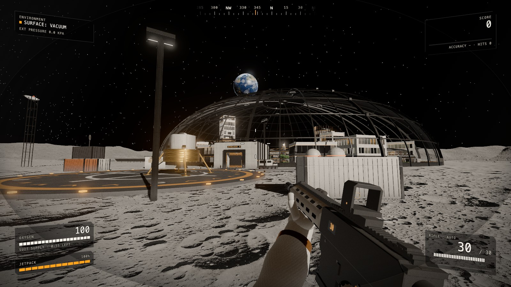
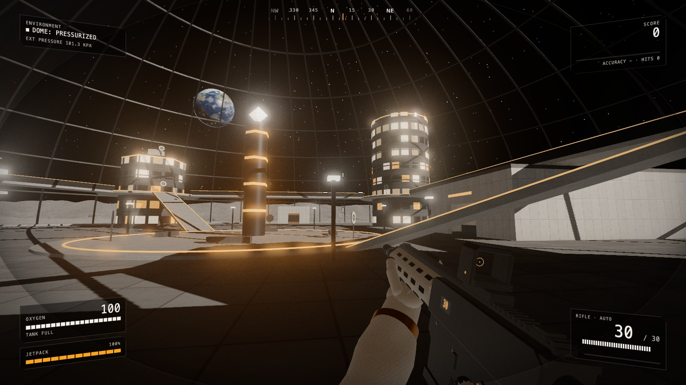

# Low-G

A first-person target shooter on the Moon, in and around a domed lunar city. It plays like the Moon: gravity is 1/6 of Earth's, so jumps are high and floaty and a jetpack gets you onto rooftops. There's no air outside the dome, so oxygen is your clock and sound barely carries.

**Play it in your browser: https://ericpeck05.github.io/low-g/**





Runs in a desktop browser with WebGL 2 (current Chrome, Edge, Firefox or Safari), with a mouse and keyboard. Click to grab the mouse and Esc to let it go.

## Controls

| Action | Key |
|---|---|
| Move | W A S D |
| Look | Mouse |
| Shoot | Left click |
| Aim down sights | Right click |
| Reload | R |
| Jump | Space |
| Jetpack | Hold Space in the air |
| Sprint | Shift |
| Crouch | C |
| Use, buy, open (hold) | E |
| Switch weapon | 1 2 3 or the wheel |
| Mouse sensitivity | [ and ] |
| Frame rate and stats | F3 |
| Pause | Esc |

## Modes

- **Range:** free practice around the city, no timer. Run out of air outside and you wake up back in the plaza.
- **Time Trial:** 60 seconds, highest score wins. Going outside costs oxygen.
- **Oxygen Run:** locked out on the surface. Every hit buys air, and the air drains faster the longer you last.
- **Drone Siege:** rounds of hostile drones that shoot back. Earn points to buy guns, open the city section by section, restore the power, install suit mods and Overclock your weapons.
- **Salvage Run:** a solar storm hits in ten minutes. Crack open the wreckage out on the plain and carry it back through an airlock before it does. The farther out, the richer, and the more drones come for you. What you bank adds up across runs and unlocks perks.

Inside the dome your oxygen refills. Out on the surface it drains, and every target you hit tops it up a little (bullseyes and drones more). High scores and settings are saved in your browser.

## Graphics quality

Settings has three levels. **Medium** is the default and is meant to hold 60 fps on a normal laptop. **High** adds soft corner shading and a sharper image for strong graphics cards, and **Low** is for older machines. Press F3 in game to see your frame rate.

## Run it yourself

You need [Node.js](https://nodejs.org) 20.19 or newer.

```bash
npm install
npm run dev
```

Then open the address it prints (usually http://localhost:5173). `npm run build` makes the production version in `dist/`. Every push to `main` builds it and publishes it to GitHub Pages (see `.github/workflows/deploy.yml`).

Every number that sets how the game feels (gravity, jump height, jetpack fuel, fire rate, oxygen drain, mouse sensitivity) is in `src/config.ts`.

## How it's made

[Three.js](https://threejs.org) for the 3D, [Rapier](https://rapier.rs) for physics and the character controller, the Web Audio API for sound, and Vite with TypeScript to build it. Everything you see and hear is generated in code when the game loads: the terrain and craters, the textures, the city, the rifle and the sound effects. No image, model or sound files are downloaded (see `ASSETS.md`).
